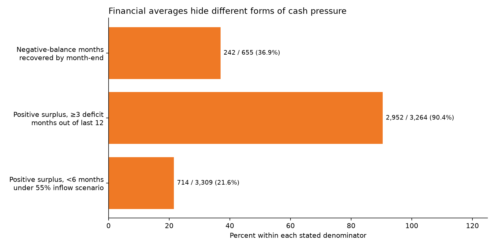

# Classification data discovery

Reproduce: `python -m plan_classification discover`. Sources: supplied Tangerine CSVs only.
All-history official baseline: 2020-01 through 2025-12; recent features: 2025-01 through 2025-12.
This is a descriptive end-of-data snapshot, not a historical prediction experiment.

## 1. Positive typical surplus does not guarantee shock resilience

714 / 3,309 (21.6%) accounts with I > S have **unrounded** official
runway below six months under the judge's 55%-of-inflow scenario. All 4,500 accounts
are eligible; denominator is the subset with I > S. No assumed eligibility, top-ups, spending cuts,
or post-benefit employment. This is an imposed scenario, not an estimated job-loss probability.
Keep reserve coverage and scenario magnitude, rather than classifying by income alone.

## 2. A typical surplus can hide repeated real deficits

2,952 / 3,264 (90.4%) positive-typical-surplus accounts with all
12 recent months had at least three actual deficit months (money_out > money_in).
Keep deficit_month_share; I-S alone is insufficient evidence for a fixed savings commitment.

## 3. Month-end balances miss within-month pressure

242 / 655 (36.9%) recent months with days_below_zero > 0
ended with nonnegative balances. This affects 145
distinct accounts; total recent records = 53,780. The denominator here is negative-balance
**months**, not accounts. Timing is a hypothesis; this does not establish bill/payday causation
or reproduce the other team's 131-account daily shock replay.
Only months with both days_below_zero and month_end_balance observed enter this ratio:
53,780 eligible records; 0 excluded for missing data.

## 4. Similar inflow/buffer, different liquidity history

Select full-12-month accounts with positive I and B. For each account, find all other accounts
within ±5% on both I and B; retain the pair with the largest difference in negative-balance month
share (sorted account/inflow order breaks ties). This is a deliberately illustrative extreme,
not a population effect estimate or a causal control.
Accounts missing the negative-balance month share are excluded from matching.

- Account 76522: I=10303.54, B=7081.86, negative-balance months=66.7%, inflow IQR/median=0.4082, deficit months=33.3%.
- Account 79632: I=10710.71, B=7121.93, negative-balance months=0.0%, inflow IQR/median=0.0041, deficit months=66.7%.

## 5. Unlabelled cash limits spending assumptions

Genuine cash withdrawals represent 76.4% of total all-history money_out (ratio of
sums, not mean of account ratios). Cash withdrawals do not reveal groceries, rent, entertainment,
or what can be cut. No discretionary-spending feature is inferred from them.
The share is undefined when any cash-withdrawal value is missing/invalid or total outflow is zero;
missing cash values are never treated as zero.

## Feature reduction decisions

Nine continuous ratios replace repeated monthly rows and most absolute amounts in classifier
inputs. Retain I/S/F/H/B/P locally for exact arithmetic and auditing. No PCA: we need named,
auditable financial drivers and there are no plan labels to validate a loss of information.
Pairs with absolute Pearson correlation ≥0.90: [('reserve_months', 'balance_change_to_spending', 0.9120029609894251)]. See feature_correlations.csv.
Correlation alone is not permission to drop a signal: negative months include unresolved
overdrafts, whereas recovered months specifically reveal hidden pressure at month-end.
No fabricated risk probability, demographic grouping, region, client ID, or account ID is a predictor.
Raw account IDs remain only in local audit exports so teammates can reproduce cases.

The labels in outputs/client_labels.csv are demographic/inflow labels, not best-plan labels.
Neither remote classifier is trained here. Both use the same canonical case. Model comparison
and held-out financial-outcome evaluation are intentionally left for the team.

## Scope and limitations

I measures bank inflows, not verified salary; B is a six-row historical mean, not spendable cash.
Recent measures use the last 12 calendar months ending at the dataset cutoff. Missing months
are flagged, never zero-filled. Ratios with zero denominators are null. Loan status is an
end-of-data snapshot; earlier as_of requests exclude it rather than leaking future status.
These bank observations cannot establish outcomes for all Canadian households.
Prior counts in the plans used unspecified/different filters and are not reproduced by assumption.

